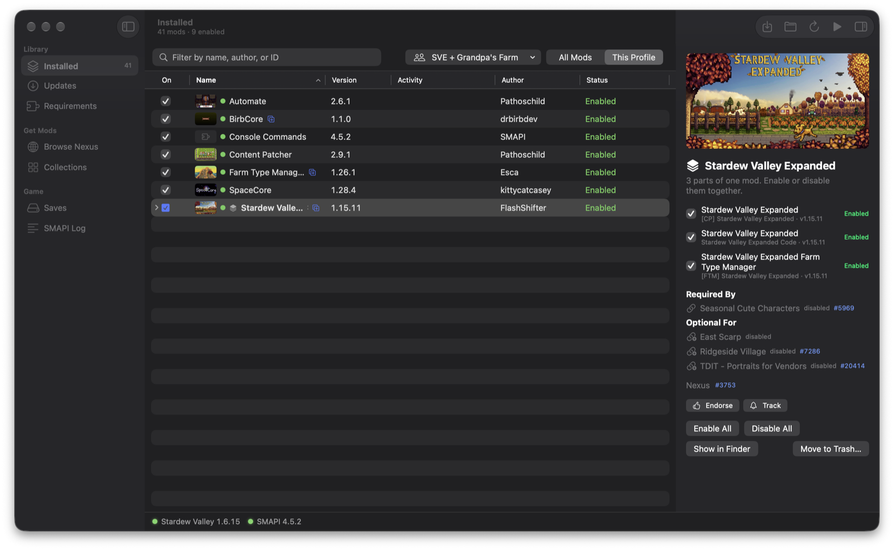
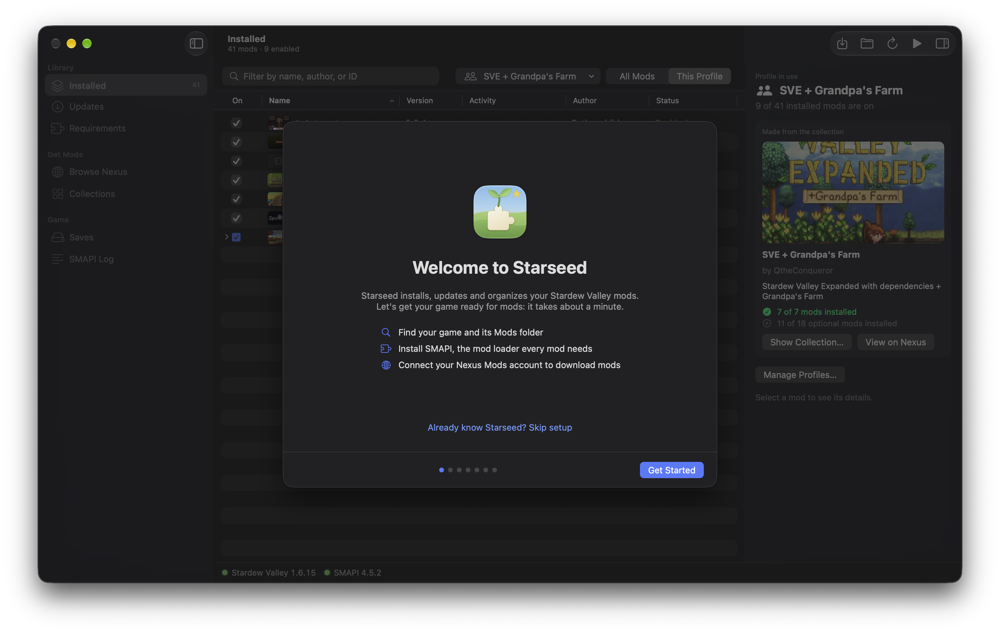
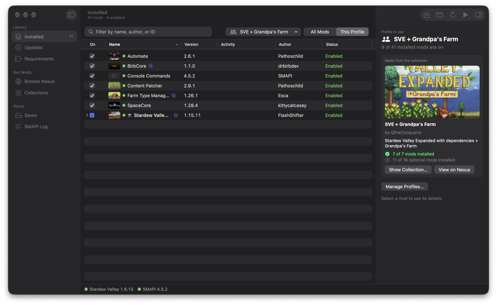
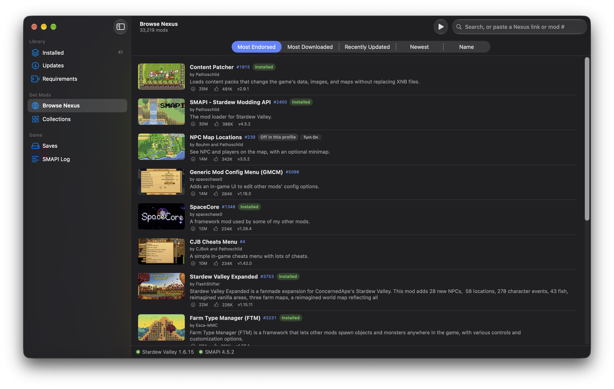
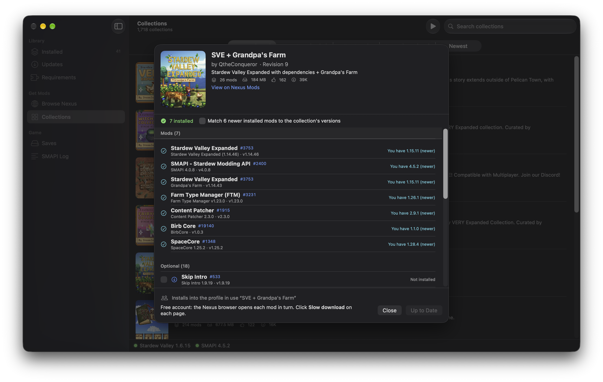
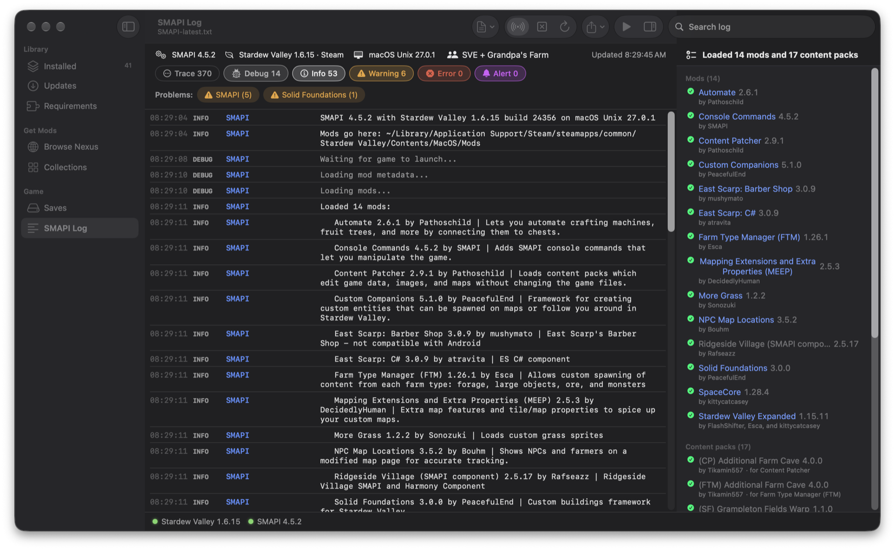
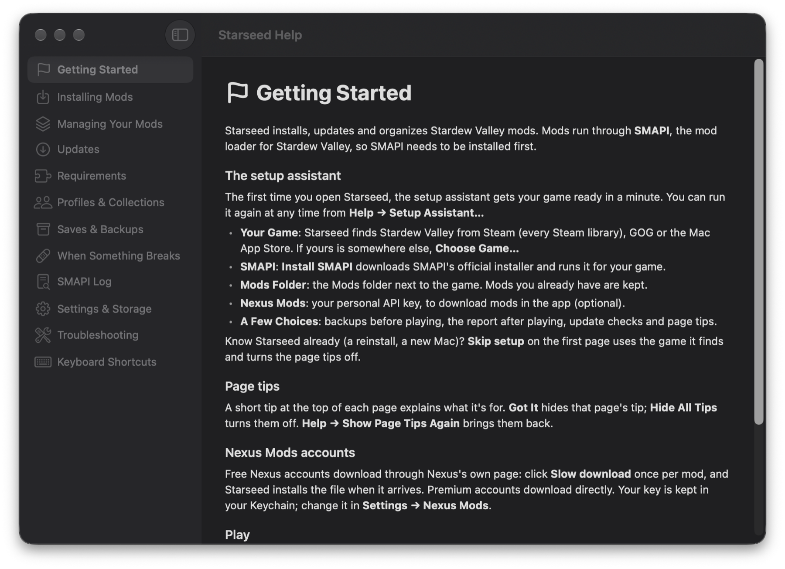

# Starseed

*A mod manager for Stardew Valley on macOS.*

Install, update and organize your Stardew Valley mods on a Mac: browse
Nexus Mods, install mods and whole collections, keep a profile for each way
you play, and find out quickly what's wrong when the game misbehaves.

**[Download Starseed for Mac](https://github.com/matguitarist/starseed/releases/latest/download/Starseed.dmg)**
(macOS 14 Sonoma or later)

## Install

1. Open the disk image and drag **Starseed** onto **Applications**.
2. The first time, macOS says it can't check Starseed, because it isn't
   signed with a paid Apple Developer ID. Open **System Settings → Privacy &
   Security**, scroll down, and click **Open Anyway**. This is needed only once:
   Starseed updates itself after that.

## Getting started

The first time you open Starseed, a setup assistant gets you ready in about
a minute:

1. **Your game:** Starseed finds Stardew Valley from Steam (in any Steam
   library), GOG or the Mac App Store. If yours is somewhere else, choose it.
2. **SMAPI:** mods run through SMAPI, the Stardew Valley mod loader. One
   click installs it with SMAPI's official installer.
3. **Mods folder:** the `Mods` folder next to the game. Mods you already have
   are kept.
4. **Nexus Mods** (optional): to download mods in the app, paste your personal
   API key; the assistant links to the page where you find it. Browsing works
   without it.
   - *Premium* accounts download directly.
   - *Free* accounts click **Slow download** once per mod on the Nexus page
     that opens in Starseed, and the mod installs itself.
5. Press **Play**.

Each page shows a short tip the first time you open it. Already know
Starseed, on a new Mac or after a reinstall? Click **Skip setup** on the first
page. You can run the assistant again from **Help → Setup Assistant…**, and
everything else is explained in **Help → Starseed Help** (⌘?).

## A quick tour

**Ready in a minute.** The setup assistant finds your game (Steam, GOG or Mac
App Store), installs SMAPI, picks the Mods folder and connects your Nexus
account. A short tip on each page explains what it's for.

**Your mods at a glance.** Every mod in your Mods folder with its picture,
version and status. Multi-part mods like Stardew Valley Expanded show as one
row. The details panel shows what a mod needs, which mods use it, and any
conflicts. At the bottom, green, yellow or red dots tell you whether the game
and SMAPI are up to date, with one-click updates.

**A profile for each way you play.** A profile remembers which mods are on:
a big expansion run, a vanilla-plus farm, a collection. Switch from the
profile menu and your mods follow; nothing is deleted. Each farm remembers the
profile it's played with, and Play switches to it first.

**Find and install mods from Nexus.** Search or browse the most popular mods,
see their requirements, and install them along with what they need. Mods you
have in another profile say so, with a button to turn them on. Updates show up
in the list; read what's new, then update one mod or all of them.

**Install whole collections.** Nexus collections (curated mod packs) install
into their own profile, so they don't mix with your other mods, and mods you
already have aren't downloaded again. Their optional mods stay one click away.

**When something breaks.** After you play, Starseed tells you if mods failed
to load, had errors or conflicted, in plain words with a button to fix each
one. The SMAPI log lists the mods that loaded. If the log doesn't say which
mod is to blame, **Find a Broken Mod** narrows it down in a few launches.

**Keep your farms safe.** Saves are backed up before you play with changed
mods, and earlier mod versions are kept so an update can be rolled back.
Everything is explained in the built-in help.

## Everything it does

**Installing**
- Browse and search Nexus Mods, see each mod's files and requirements, and
  install with what it needs.
- Install Nexus collections into their own profile, or your own mod archives
  (.zip, .7z, .rar) by dropping them on the window.
- Install, update and reconnect SMAPI in one click.
- A setup assistant for first launch, and a tip on each page.
- Mods that aren't on Nexus (ModDrop, GitHub…) get a button to their page.

**Keeping up to date**
- Checks every mod for updates at launch and every few hours, with
  notifications.
- A menu bar icon (you can turn it off) to play, switch profiles and see
  updates without opening the window.
- Read what's new before updating, update one mod or all of them.
- Every update keeps the previous version, so you can roll back.
- Tells you when Steam has a game update waiting.

**Organizing**
- Turn mods on and off (⌘Z undoes it), with multi-part mods kept together.
- Profiles for different ways of playing: switch in one click, see only a
  profile's mods, and start one from no mods or from a collection.
- Export a profile (mods, versions and settings) and import it on another Mac
  or share it with a friend; missing mods download into it.
- Edit a mod's settings in a simple form.
- Spots mods installed twice, missing requirements, and requirements nothing
  uses anymore after you remove a mod.
- Settings → Storage shows what takes space and cleans up old versions and
  backups.

**When something goes wrong**
- A readable SMAPI log with colors, filters and plain-language advice.
- A report after each game session: mods that didn't load, had errors,
  conflicted or crashed the game.
- Find a Broken Mod: a guided search that names the culprit in a few tests.
- Finds which mods a save needs, for example a farm copied from another
  computer, and installs the missing ones.
- Save backups: back up and restore one farm or all of them; Play backs up
  your saves when your mods changed.
- Saves are grouped by profile: each farm remembers the profile it's played
  with, and Play switches to it first.

**Languages:** English, French, German, Spanish, Brazilian Portuguese and
Simplified Chinese (Settings → General → Language).

**Light or dark:** follows macOS, or pick one in Settings → General.

## Good to know

- Works with the Steam, GOG and Mac App Store versions of the game. Play
  launches Steam's copy through Steam and opens the others directly.
- Free Nexus accounts need one click per mod ("Slow download"): Nexus only
  allows direct downloads in apps for Premium members.
- Signing in to Nexus with Google or Apple inside Starseed's browser may be
  blocked by those services. Use your Nexus email and password, or set
  Starseed as the handler for "Mod Manager Download" links (Settings → Nexus
  Mods) and click them in your usual browser.
- Removed mods and old versions go to the Trash, so they can be recovered.
- Starseed keeps its settings, profiles, kept versions and save backups in
  `~/Library/Application Support/StardewModManager/`.

## Help and feedback

- In the app: **Help → Starseed Help** (⌘?).
- Found a bug or have an idea? [Open an issue](https://github.com/matguitarist/starseed/issues/new/choose)
  (English or French is fine).
- Building it yourself or contributing: see [DEVELOPMENT.md](DEVELOPMENT.md).

Starseed is free and open source (MIT license). It isn't affiliated with
ConcernedApe, SMAPI or Nexus Mods.
